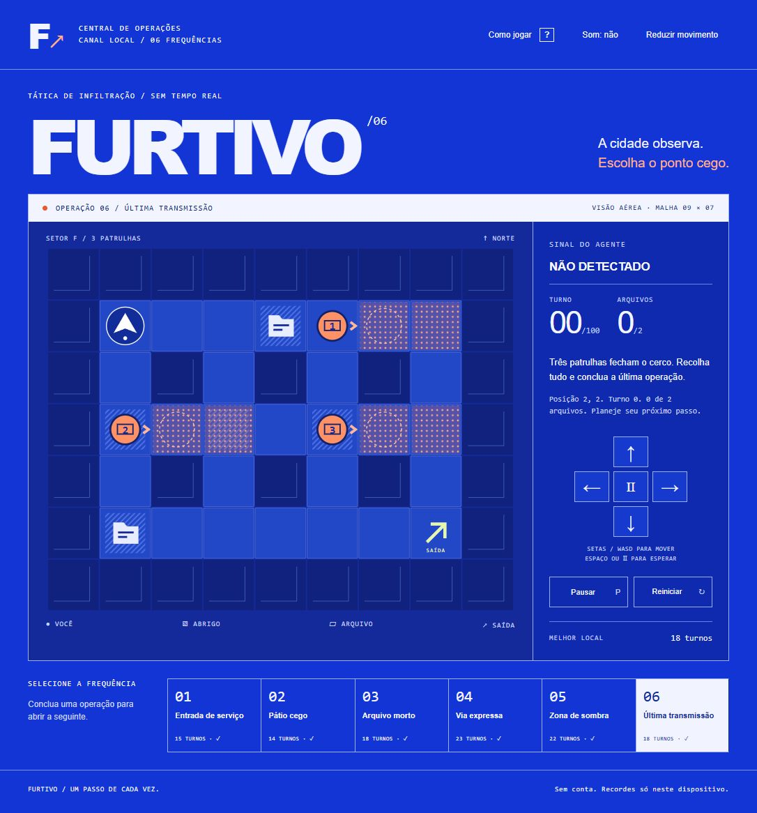

# Furtivo

**A cidade observa. Escolha o ponto cego.**

[Jogar gratuitamente](https://gustapaz.github.io/furtivo/)

Infiltração tática por turnos em seis operações autorais. Recolha dois arquivos, antecipe as patrulhas e alcance a saída sem ser visto. Campanha completa, progressão local e recordes de menor número de turnos por operação. Sem conta, servidor ou serviços pagos.



## Jogar

- Clique no mapa para focá-lo; setas/WASD movem uma casa. Espaço espera um turno.
- Botões direcionais na tela permitem clique/toque. O botão Ⅱ espera.
- Cada ação válida move as patrulhas. Paredes não gastam turno.
- A trama laranja mostra o olhar atual e o círculo tracejado indica o próximo passo. Após sua ação, os guardas andam e olham na nova direção. Visão: duas casas, interrompida por paredes.
- Abrigos hachurados e cabines de arquivo escondem da visão, inclusive após a coleta. Contato com a casa atual ou seguinte de uma patrulha sempre causa alarme.
- Dois arquivos + saída = vitória. Detecção ou 100 turnos = derrota.
- P pausa no campo focado; Escape fecha diálogos. Áudio opcional, desligado por padrão. Movimento reduzido disponível e preferência do sistema respeitada.

## Executar

JavaScript nativo com Web Components autônomos, SVG e CSS. **Nenhuma dependência npm**, framework, engine, fonte remota ou asset externo. Node 24 para testes/export; Python 3 para servidor local.

```sh
npm test
npm run build
npm run dev
```

Abra `http://127.0.0.1:4177/`. Para testar o export, execute `python -m http.server 4177 --bind 127.0.0.1 --directory dist`. O build copia somente a lista explícita de arquivos públicos. Caminhos relativos funcionam na subpasta `/furtivo/`.

## Arquitetura e privacidade

`src/game.js` é um modelo puro e imutável. `src/app.js` implementa um Custom Element com renderização SVG e controles DOM. Não há loop por frame: patrulhas só mudam com a ação do jogador. Pausa ao perder foco/visibilidade, retomada explícita, reinício limpo. Efeitos sonoros sintetizados após interação com Web Audio.

Progresso, recordes e preferências ficam em `localStorage` no dispositivo. Save inválido é descartado; indisponibilidade de armazenamento não impede jogar. A tentativa atual não persiste ao recarregar. Recordes locais podem ser alterados pelo próprio usuário; não representam competição online. Não há promessa de cache/offline. O host GitHub Pages tem sua própria política de logs de acesso.

Hospedagem estática gratuita em repositório público pelo GitHub Pages. Sem cadastro de cartão, faturamento, trial, APIs de consumo ou compras no jogo. [Disponibilidade do Pages no GitHub Free](https://docs.github.com/en/pages/getting-started-with-github-pages/what-is-github-pages).

## Qualidade e licença

Veja [design](docs/game-design.md), [validação](docs/validation.md) e [assets](docs/assets.md). Layout móvel não equivale a teste em telefone físico. Não alegamos suporte universal, auditoria completa de acessibilidade ou medição universal de FPS.

Código e arte originais sob licença [MIT](LICENSE), © 2026 Gustavo Paz.
